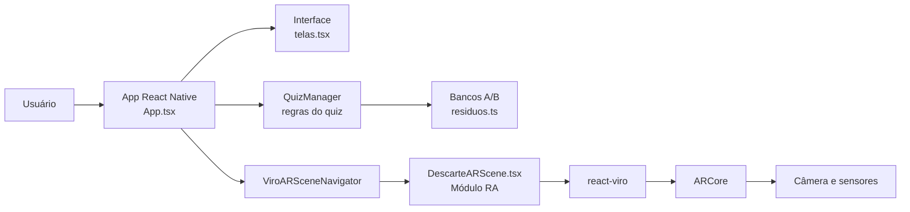
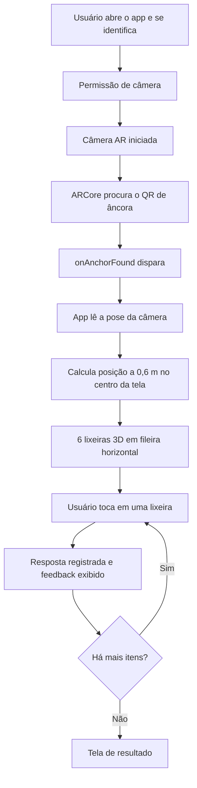

# descartAR

Aplicativo Android de Realidade Aumentada que ensina o descarte correto de resíduos por meio de um quiz: o usuário toca em lixeiras 3D coloridas (padrão CONAMA) para classificar cada resíduo e aprender com o feedback imediato.

---

## 1. Identificação do Projeto

| Item | Informação |
| --- | --- |
| Projeto | descartAR |
| Equipe | descartAR |
| Curso | Engenharia da Computação, Centro Universitário Facens |
| Disciplina | UPX801 - Usina de Projetos Experimentais: Realidade Aumentada |
| Professor | Prof. Dr. Daniel Ohata |
| Semestre | 2026/2 |

### Integrantes

| Nome | RA | Responsabilidade |
| --- | --- | --- |
| Gabrielle Marchioli | 236775 | Desenvolvimento React Native/TypeScript, integração com Viro (ARCore), cena AR, lógica do quiz, bancos de questões, testes em dispositivo |
| Afonso Henrique | 235385 | Desenvolvimento React Native/TypeScript |
| Giulianno Gonçalves | 235484 | integração com Viro (ARCore) |
| Kaique Vecchia Alves | 235446 | bancos de questões |
| Micael Almeida Teodoro Dos Reis | 234941 | Documentação |
| Nathalia Atamanchuk Baleeiro | 235215 | Documentação |

---

## 2. Visão Geral

O descartAR trata o descarte incorreto de resíduos recicláveis e não recicláveis, um problema comum entre pessoas que sabem separar o lixo "óbvio" (garrafa PET, lata), mas erram com itens ambíguos (caixa de pizza engordurada, espelho, embalagem de salgadinho).

A solução é um quiz em Realidade Aumentada. O usuário aponta a câmera do celular para um QR Code de âncora, e seis lixeiras 3D coloridas aparecem lado a lado no centro da tela. O app mostra um resíduo por vez, e o usuário toca na lixeira que considera correta. Quando erra, recebe uma justificativa curta e a lixeira correta é destacada.

A Realidade Aumentada participa em dois pontos: o QR Code é reconhecido como imagem de referência (Image Tracking do ARCore) e dispara o posicionamento das lixeiras no ambiente, e a interação (toque nas lixeiras) acontece diretamente nos objetos 3D.

O app tem dois bancos de questões equivalentes (A e B), que permitem aplicar um pré-teste e um pós-teste sem repetir itens.

---

## 3. Problema

- **Contexto:** a coleta seletiva depende de o cidadão separar os resíduos corretamente em casa ou no trabalho.
- **Situação atual:** a maioria das pessoas acerta itens comuns, mas erra os ambíguos, que contaminam materiais recicláveis ou desperdiçam material reciclável descartado como lixo comum.
- **Dificuldade:** materiais educativos tradicionais (cartazes, folhetos) são passivos e não dão retorno imediato sobre o erro.
- **Público afetado:** estudantes, moradores e trabalhadores em geral.
- **Impacto:** contaminação de lotes de reciclagem, aumento de rejeito enviado a aterro e baixa eficiência das cooperativas.

---

## 4. Objetivos

**Objetivo geral:** desenvolver um aplicativo de Realidade Aumentada que treine e meça o conhecimento sobre descarte correto de resíduos por meio de um quiz interativo.

**Objetivos técnicos:**

- reconhecer um QR Code de âncora como imagem de referência (Image Tracking);
- posicionar seis lixeiras 3D no ambiente a partir do reconhecimento do marcador;
- permitir interação por toque diretamente nos objetos 3D;
- exibir feedback educativo imediato a cada resposta;
- manter dois bancos de questões equivalentes (pré e pós-teste);
- executar a aplicação em dispositivo Android real.

---

## 5. Público-Alvo

- Jovens e adultos com smartphone Android, sem necessidade de familiaridade com RA.
- Uso em sessões curtas (cerca de 5 a 6 minutos), em ambiente interno e iluminado, com o QR impresso.
- A interface usa poucos botões e instruções diretas, para uso por participantes de pesquisa sem treinamento prévio.

---

## 6. Funcionalidades

| ID | Funcionalidade | Descrição | Status |
| --- | --- | --- | --- |
| RF01 | Identificação do participante | Tela inicial com identificação e escolha do banco (A ou B) | ✅ |
| RF02 | Permissão de câmera | Solicita permissão de câmera no Android antes de abrir a RA | ✅ |
| RF03 | Reconhecer QR de âncora | Detecta a imagem do QR com moldura via Image Tracking | ✅ |
| RF04 | Posicionar lixeiras | Posiciona as 6 lixeiras lado a lado no centro da tela, após o reconhecimento | ✅ |
| RF05 | Manter lixeiras sem o QR | Após o reconhecimento, as lixeiras permanecem mesmo sem o QR no quadro | ✅ |
| RF06 | Selecionar lixeira por toque | Toque direto na lixeira 3D registra a resposta | ✅ |
| RF07 | Animação de seleção | A lixeira tocada sobe e desce | 🚧 |
| RF08 | Feedback educativo | Mostra acerto ou erro e a justificativa, com destaque da lixeira correta | ✅ |
| RF09 | Pular item | Permite pular o resíduo atual (após encontrar o QR) | ✅ |
| RF10 | Sair da sessão | Modal de confirmação para sair e descartar a sessão | ✅ |
| RF11 | Banco de questões A e B | 30 itens por banco, 5 por lixeira, 15 diretos e 15 ambíguos | ✅ |
| RF12 | Tela de resultado | Resumo da sessão ao final do quiz | ✅ |
| RF13 | Suporte a iOS | Execução em iPhone | ❌|

Legenda: ✅ Implementado, 🚧 Em desenvolvimento, ⬜ Planejado, ❌ Cancelado.

---

## 7. Requisitos Não Funcionais

- **Compatibilidade:** Android com suporte a ARCore e Google Play Services for AR.
- **Hardware:** câmera traseira funcional; sem necessidade de internet após a instalação.
- **Usabilidade:** toque direto nas lixeiras, instrução na tela enquanto o QR não é encontrado.
- **Desempenho:** execução fluida em celular de linha intermediária (ver seção 22).
- **Segurança e privacidade:** o app solicita apenas a permissão de câmera.

---

## 8. Tecnologias Utilizadas

| Tecnologia | Versão | Utilização |
| --- | --- | --- |
| React Native (CLI) | 0.86.0 | Aplicativo móvel |
| React | 19.2.3 | Interface e estado |
| TypeScript | 5.9.3 | Tipagem do código |
| @reactvision/react-viro | ^3.0.3 | Componentes de RA (cena, marcador, objetos 3D, animações) |
| ARCore | Via Viro | Rastreamento de imagem e movimento no Android |
| Hermes | Padrão do RN 0.86 | Engine JavaScript |
| Gradle | 9.3.1 | Build Android |
| JDK | 17 | Build Android |
| Python | 3.12.10 | Script gerador do QR (`gerar_qr.py`) |
| Git e GitHub | - | Controle de versão |

---

## 9. Hardware Utilizado

| Equipamento | Detalhes | Finalidade |
| --- | --- | --- |
| Computador | Windows | Desenvolvimento e build |
| Motorola Moto G75 5G | Android 16, arm64 | Dispositivo principal de teste |
| Xiaomi 22101316UG | Android 16, arm64 | Dispositivo reserva de teste |
| QR de âncora | geralmente na tela do notebook | Marcador de RA |

---

## 10. Arquitetura do Sistema



Não há servidor, API ou banco de dados externo: todo o processamento ocorre no dispositivo.

---

## 11. Funcionamento da Realidade Aumentada

**Abordagem:** Image Tracking com QR Code como marcador de âncora. O QR funciona só como gatilho: depois de reconhecido, as lixeiras permanecem no mundo AR sem precisar do marcador no quadro.

**Tecnologia:** `ViroARImageMarker` e `ViroARTrackingTargets` (react-viro) sobre o ARCore. A imagem de referência é `src/assets/qr_ancora.png`, cadastrada com `physicalWidth` de 0,15 m.

**Marcador:** o ARCore rastreia melhor imagens com muitos pontos de contraste. Por isso o QR é cercado por uma moldura de blocos coloridos aleatórios, gerada por `gerar_qr.py`.

**Fluxo:**



As posições são calculadas uma única vez no momento do reconhecimento, a partir do raio central da câmera, e ficam fixas no mundo AR. Se a pose da câmera não estiver disponível, o app usa a posição do QR como alternativa.

---

## 12. Estrutura do Projeto

```text
DescarteAR2/
├── App.tsx
├── gerar_qr.py
├── package.json
├── android/
├── docs/
│   ├── diagrams/
│   ├── images/
│   └── documents/
└── src/
    ├── ar/
    │   └── DescarteARScene.tsx
    ├── assets/
    │   └── qr_ancora.png
    ├── data/
    │   ├── lixeiras.ts
    │   └── residuos.ts
    ├── quiz/
    │   └── QuizManager.ts
    └── ui/
        └── telas.tsx
```

| Pasta ou arquivo | Função |
| --- | --- |
| `App.tsx` | Fluxo de telas, permissão de câmera, ligação entre quiz e cena AR |
| `src/ar/` | Cena de RA: marcador, lixeiras 3D, toque e animação |
| `src/assets/qr_ancora.png` | Imagem do marcador (QR com moldura) |
| `src/data/lixeiras.ts` | Definição das 6 lixeiras (id, nome, cor) |
| `src/data/residuos.ts` | Bancos de questões A e B |
| `src/quiz/` | Regras do quiz |
| `src/ui/` | Telas e componentes de interface |
| `gerar_qr.py` | Gera a imagem do QR com moldura |

---

## 13. Principais Componentes

| Componente | Responsabilidade |
| --- | --- |
| `App.tsx` | Controla as etapas (identificação, preparo, quiz, resultado), trava de toque durante o feedback, estado do marcador |
| `DescarteARScene.tsx` | Registra o alvo de rastreamento, posiciona as lixeiras, trata o toque e a animação |
| `QuizManager.ts` | Sorteia a ordem dos itens, avalia respostas, controla progresso e gera o resumo |
| `residuos.ts` | Resíduos, destino correto, justificativa e marcação de item ambíguo |
| `lixeiras.ts` | Lixeiras e cores no padrão CONAMA |
| `telas.tsx` | Tela de identificação, preparo, resultado, HUD do quiz e feedback |
| `gerar_qr.py` | Gera o QR de âncora com moldura de texturas |

Lixeiras e cores (CONAMA): papel (azul), plástico (vermelho), vidro (verde), metal (amarelo), orgânico (marrom), rejeito (cinza).

---

## 14. Dependências

- `react-native` 0.86.0
- `react` 19.2.3
- `@reactvision/react-viro` ^3.0.3 ([repositório](https://github.com/ReactVision/viro))
- Google Play Services for AR (instalado pela Play Store no celular)

A lista completa e as versões exatas estão em `package.json` e `package-lock.json`.

---

## 15. Configuração do Ambiente

Ambiente de desenvolvimento em Windows:

1. Instalar o Node.js
2. Instalar o JDK 17.
3. Instalar o Android Studio com Android SDK, Platform-Tools e NDK/CMake.
4. Configurar as variáveis `ANDROID_HOME` e `JAVA_HOME`.
5. Instalar o Git.
6. Instalar o Python 3 com `pip install qrcode pillow` (só se for regenerar o QR).
7. No celular: ativar Opções do desenvolvedor e Depuração USB (em Xiaomi, ativar também "Instalar via USB").
8. Conferir se o celular é compatível com ARCore: [lista de dispositivos](https://developers.google.com/ar/devices).

Para validar o ambiente: `npx react-native doctor`.

---

## 16. Como Executar o Projeto

```bash
git clone https://github.com/GabrielleMarchioli/upx8---descartAR
cd DescarteAR2
npm install
```

Com o celular conectado por USB:

```bash
adb devices
adb reverse tcp:8081 tcp:8081
npx react-native run-android
```

O `adb devices` deve listar o aparelho como `device`. O `run-android` compila, instala o app e inicia o Metro. O primeiro build é lento.

Para mudanças apenas de código, basta `npx react-native start` e pressionar `r` no Metro.

Se a porta 8081 estiver ocupada:

```bash
netstat -ano | findstr :8081
taskkill /PID <numero> /F
```

Para gerar o QR de âncora:

```bash
python gerar_qr.py src/assets/qr_ancora.png
```

---

## 17. Como Utilizar a Aplicação

1. Utilizar QR de âncora (`src/assets/qr_ancora.png`), pode ser impresso ou na tela do PC.
2. Abrir o app e preencher a identificação do participante.
3. Escolher o banco de questões (A ou B).
4. Autorizar a câmera.
5. Tocar em abrir a câmera na tela de preparo.
6. Apontar o celular para o QR até as lixeiras aparecerem lado a lado no centro da tela.
7. Ler o resíduo exibido no topo e tocar na lixeira correspondente com um toque rápido.
8. Ler o feedback (acerto ou erro com justificativa). A lixeira correta fica destacada quando há erro.
9. Repetir até o fim dos itens e conferir a tela de resultado.

Os botões pular e sair ficam na barra do quiz.

---

## 18. Diagramas

Os diagramas de arquitetura e de fluxo da RA estão nas seções 10 e 11. Arquivos de imagem exportados ficam em `docs/diagrams/`.

---

## 19. Interface da Aplicação

| Tela | Finalidade | Elementos principais | Ação do usuário |
| --- | --- | --- | --- |
| Identificação | Registrar o participante e o banco | Campo de identificação, escolha A/B | Preencher e continuar |
| Preparo | Orientar antes de abrir a câmera | Instruções, botão de abrir câmera | Abrir a câmera |
| Quiz em RA | Classificar os resíduos | Câmera, 6 lixeiras 3D, resíduo atual, progresso, pular, sair | Tocar na lixeira |
| Feedback | Ensinar após cada resposta | Acerto ou erro, justificativa | Ler |
| Resultado | Mostrar o desempenho | Resumo da sessão | Reiniciar |


[PREENCHER: adicionar as capturas de tela em `docs/images/` com esses nomes]

---

## 20. Testes Técnicos

| Teste | Procedimento | Resultado esperado | Resultado obtido | Status |
| --- | --- | --- | --- | --- |
| Câmera | Abrir a RA | Câmera abre | Abre no Moto G75 5G | ✅ |
| Reconhecimento do QR | Apontar para o QR impresso | Detectar a imagem | Detectado | ✅ |
| Posicionamento | Reconhecer o QR | 6 lixeiras lado a lado, no centro da tela | Posicionadas | ✅ |
| Persistência | Tirar o QR do quadro | Lixeiras permanecem | Permanecem | ✅ |
| Toque na lixeira | Tocar em cada lixeira | Resposta registrada | Funciona; houve falhas intermitentes que diminuíram após ajustes | ✅ |
| Feedback | Responder certo e errado | Mostrar feedback e destaque | Exibido | ✅ |
| Animação da lixeira | Tocar na lixeira | Subir e descer | Lixeiras sobem e descem correspondentes ao toque | ✅ |
| Fim da sessão | Responder todos os itens | Tela de resultado | Tela de resultado e export do JSON | ✅ |

---

## 21. Dispositivos Testados

| Dispositivo | Sistema | Versão | Resultado |
| --- | --- | --- | --- |
| Motorola Moto G75 5G | Android | 16 | Compatível (câmera, QR, lixeiras e toque funcionando) |
| Xiaomi 22101316UG | Android | 16 | (câmera, QR, lixeiras e toque funcionando) |

Apenas dispositivos efetivamente testados devem constar na tabela.

---

## 22. Limitações Conhecidas

- Funciona somente em Android com ARCore; iOS não foi implementado nem testado.
- Depende do QR impresso para iniciar; o marcador precisa de papel fosco e boa iluminação.
- O toque exige um toque rápido e sem arrastar; toques longos ou com deslize podem não ser reconhecidos pelo Viro.
- As lixeiras são posicionadas uma única vez, no reconhecimento; se o rastreamento do ARCore se perder, elas podem se deslocar.
- Os dados de resposta ficam apenas na sessão do app, sem sincronização com servidor.
- Justificativas de itens como isopor, copo descartável e caixa longa vida dependem das regras de coleta de cada cidade.
- Em celulares Xiaomi é preciso habilitar "Instalar via USB" para instalar o app em desenvolvimento.

---

## 23. Evidências de Funcionamento

- [PREENCHER: link do vídeo de demonstração]
- [PREENCHER: capturas de tela ou GIF em `docs/images/`]

---

## 24. Problemas Encontrados e Soluções

**Problema:** o app fechava ao abrir a câmera (crash nativo com `SIGSEGV`).
**Causa:** o componente `<ViroCamera>` dentro de uma cena AR causa falha nativa no renderer do Viro.
**Solução:** remover o `<ViroCamera>`; em RA a câmera já é controlada pelo ARCore.

**Problema:** o ARCore não reconhecia bem um QR Code simples como imagem de referência.
**Causa:** o QR tem poucos pontos de contraste distintos para o rastreamento de imagem.
**Solução:** gerar o marcador com moldura de blocos coloridos aleatórios ao redor do QR (`gerar_qr.py`).

**Problema:** lixeiras muito próximas, com nomes sobrepostos, e difíceis de tocar.
**Causa:** posicionamento em grade ao redor do QR, em escala pequena.
**Solução:** fileira única centralizada pela câmera no momento do reconhecimento, com mais espaçamento e área de toque invisível maior que cada lixeira.

**Problema:** toques intermitentes não eram reconhecidos.
**Causa:** o Viro só gera o evento em toques curtos sobre a geometria; o callback de posição da câmera também sobrecarregava a thread de JavaScript.
**Solução:** área de toque ampliada e remoção do callback de câmera depois do reconhecimento.

**Problema:** tela branca e erro "Unable to load script".
**Causa:** o Metro estava em uma porta diferente da usada pelo app (8081 ocupada).
**Solução:** liberar a porta 8081 e executar `adb reverse tcp:8081 tcp:8081`.

**Problema:** `INSTALL_FAILED_USER_RESTRICTED` ao instalar em celular Xiaomi.
**Causa:** a instalação via USB é bloqueada por padrão nesse sistema.
**Solução:** ativar "Instalar via USB" e "Depuração USB (configurações de segurança)" e aceitar o pop-up no celular.

**Problema:** erro de ordem dos hooks do React durante o desenvolvimento.
**Causa:** Fast Refresh ao editar o `App.tsx` com o app aberto.
**Solução:** pressionar `r` no Metro ou reabrir o app; não é falha do código.

---

## 25. Cronograma Técnico

| Atividade | Responsável | Status |
| --- | --- | --- |
| Configuração do ambiente React Native e Viro | Gabrielle | ✅ |
| Execução em dispositivo Android | Gabrielle | ✅ |
| Marcador QR de âncora | Gabrielle | ✅ |
| Lixeiras 3D e interação por toque | Gabrielle | ✅ |
| Bancos de questões A e B (30 itens cada) | Gabrielle | ✅ |
| Animação das lixeiras | Gabrielle | ✅ |
| Testes e documentação | Afonso, Nathalia, Micael, Kaique | 🚧 |
| Coleta de dados | Afonso | ✅ |

---

## 26. Controle de Versão

O projeto usa Git e GitHub, com commits pequenos e descritivos, por exemplo:

```text
feat: implementa QR como ancora das lixeiras
feat: posiciona lixeiras lado a lado no centro da tela
fix: aumenta area de toque das lixeiras
docs: atualiza README com procedimentos de instalacao
```

---

## 27. Referências

- [Viro React](https://github.com/ReactVision/viro)
- [ARCore: imagens aumentadas](https://developers.google.com/ar/develop/augmented-images)
- [ARCore: dispositivos compatíveis](https://developers.google.com/ar/devices)
- [Resolução CONAMA nº 275/2001](https://conama.mma.gov.br/?option=com_sisconama&task=arquivo.download&id=272) (código de cores da coleta seletiva)
- [Modelo de documentação da disciplina](https://github.com/dr-ohata/upx-modelo)
